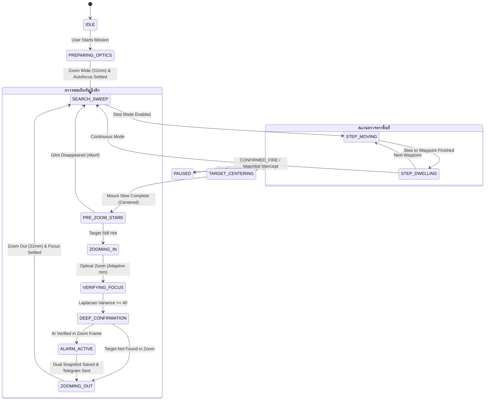

> Deployment note (2026-10-17): this is the imported runtime reference.
> Install from the repository root using `docs/NEW_STATION_TH.md`; the source now
> lives in `camera_runtime/`. Desktop paths and old service commands below are
> historical examples. Configure credentials in ignored `system_settings.json`.

# 🔥 Fire Sentinel 360 — Integrated Fire Detection & Autonomous PTZ Surveillance System

ระบบเฝ้าระวังไฟป่าและตรวจจับความร้อนอัตโนมัติรอบทิศทาง 360 องศา (Autonomous Sentry) แบบรวมศูนย์ระดับอุตสาหกรรม ผสานรวมระบบตรวจจับความร้อนคอมพิวเตอร์วิทัศน์ขั้นสูง (Computer Vision), โครงข่ายประสาทเทียม Deep Learning (NCNN YOLO), ระบบติดตามพิกัดเชิงมุมด้วย Kalman Filter, เครื่องมือวิเคราะห์การเติบโตของไฟด้วย Linear Regression, ปัญญาประดิษฐ์ยืนยันเพลิงไหม้ Multimodal LLM, การถ่ายภาพพาโนรามาความร้อนทรงกลม 360° และการส่งภาพสตรีมมิ่งสดความหน่วงต่ำผ่านเครือข่าย 4G/VPN

---

## 📑 สารบัญ (Table of Contents)
1. [ภาพรวมสถาปัตยกรรมระบบ (System Architecture)](#1-ภาพรวมสถาปัตยกรรมระบบ-system-architecture)
2. [ฮาร์ดแวร์และระบบกล้องคู่ (Dual Camera & Hardware Integration)](#2-ฮาร์ดแวร์และระบบกล้องคู่-dual-camera--hardware-integration)
3. [ระบบตรวจจับความร้อนและอัลกอริทึม Computer Vision / AI (Detection Pipeline)](#3-ระบบตรวจจับความร้อนและอัลกอริทึม-detection-pipeline)
   - [3.1 Classic Thermal Hotspot Detector (4 Core Methods)](#31-classic-thermal-hotspot-detector-4-core-methods)
   - [3.2 Aspect Ratio, Fireline & Wire Rejection Filters](#32-aspect-ratio-fireline--wire-rejection-filters)
   - [3.3 Solar Heat Rejection & Confidence Scoring](#33-solar-heat-rejection--confidence-scoring)
   - [3.4 Deep Learning AI Engine (NCNN YOLO26n)](#34-deep-learning-ai-engine-ncnn-yolo26n)
   - [3.5 กลไกการทริกเกอร์ตรวจจับ (Inference Trigger Modes)](#35-กลไกการทริกเกอร์ตรวจจับ-inference-trigger-modes)
4. [ระบบติดตามเป้าหมายและยืนยันเพลิงไหม้ (Kalman Tracking & Verification)](#4-ระบบติดตามเป้าหมายและยืนยันเพลิงไหม้-kalman-tracking--verification)
   - [4.1 8-State Kalman Box Tracker](#41-8-state-kalman-box-tracker)
   - [4.2 1D Kalman Score Smoothing Filter](#42-1d-kalman-score-smoothing-filter)
   - [4.3 World-Coordinate Angular Projection (Azimuth / Altitude)](#43-world-coordinate-angular-projection)
   - [4.4 Multi-Metric Bipartite Association](#44-multi-metric-bipartite-association)
   - [4.5 Thermal Core Analysis & Verification State Machine](#45-thermal-core-analysis--verification-state-machine)
5. [ระบบควบคุมภารกิจอัตโนมัติ (Autonomous Sentry Mission Controller)](#5-ระบบควบคุมภารกิจอัตโนมัติ-autonomous-sentry-mission-controller)
   - [5.1 แผนผังสถานะภารกิจ (Finite State Machine - 12 States)](#51-แผนผังสถานะภารกิจ-finite-state-machine---12-states)
   - [5.2 รูปแบบการสแกน (Continuous Sweep vs Step-and-Dwell Snake Grid)](#52-รูปแบบการสแกน-continuous-sweep-vs-step-and-dwell-snake-grid)
   - [5.3 อัลกอริทึมเล็งเป้าหมายกึ่งกลางภาพ (Auto-Centering Algorithm)](#53-อัลกอริทึมเล็งเป้าหมายกึ่งกลางภาพ-auto-centering-algorithm)
   - [5.4 อัลกอริทึมคำนวณระยะซูมอัจฉริยะ (Adaptive Optical Zoom)](#54-อัลกอริทึมคำนวณระยะซูมอัจฉริยะ-adaptive-optical-zoom)
   - [5.5 การตรวจสอบเป้าหมายก่อนซูม (Pre-Zoom Stationary Stare Check)](#55-การตรวจสอบเป้าหมายก่อนซูม-pre-zoom-stationary-stare-check)
   - [5.6 การตรวจสอบความคมชัดของโฟกัส (Laplacian Variance Sharpness Metric)](#56-การตรวจสอบความคมชัดของโฟกัส-laplacian-variance-sharpness-metric)
   - [5.7 บัญชีเฝ้าระวังและการดับของไฟ (Hotspot Watchlist & Extinguishment)](#57-บัญชีเฝ้าระวังและการดับของไฟ-hotspot-watchlist--extinguishment)
6. [การบันทึกประวัติและวิเคราะห์แนวโน้มการลุกลาม (Incident History & Growth Analysis)](#6-การบันทึกประวัติและวิเคราะห์แนวโน้มการลุกลาม-incident-history--growth-analysis)
   - [6.1 การจับคู่พิกัดข้ามรอบสแกน (Spatial Matching with 360° Wrap)](#61-การจับคู่พิกัดข้ามรอบสแกน-spatial-matching-with-360-wrap)
   - [6.2 การสกัดขนาดพื้นที่เผาไหม้จริง (True Thermal Mask Extraction)](#62-การสกัดขนาดพื้นที่เผาไหม้จริง-true-thermal-mask-extraction)
   - [6.3 อัลกอริทึมวิเคราะห์การเติบโตด้วย Linear Regression](#63-อัลกอริทึมวิเคราะห์การเติบโตด้วย-linear-regression)
7. [ระบบยืนยันภาพถ่ายด้วย Multimodal LLM (AI Cloud / Local Verifier)](#7-ระบบยืนยันภาพถ่ายด้วย-multimodal-llm-ai-cloud--local-verifier)
   - [7.1 สถาปัตยกรรม Multimodal Verification (OpenAI Compatible)](#71-สถาปัตยกรรม-multimodal-verification-openai-compatible)
   - [7.2 การวิเคราะห์ภาพคู่ (Visible Context + Thermal Signature)](#72-การวิเคราะห์ภาพคู่-visible-context--thermal-signature)
   - [7.3 ระบบระงับพิกัดเตือนลวงชั่วคราว (False Alarm Exclusion Zones)](#73-ระบบระงับพิกัดเตือนลวงชั่วคราว-false-alarm-exclusion-zones)
8. [ระบบแจ้งเตือนเหตุการณ์ผ่าน Telegram (Telegram Bot Notifier)](#8-ระบบแจ้งเตือนเหตุการณ์ผ่าน-telegram-telegram-bot-notifier)
9. [ระบบถ่ายและต่อภาพพาโนรามาความร้อน 360° (Thermal Panorama Engine & Stitcher)](#9-ระบบถ่ายและต่อภาพพาโนรามาความร้อน-360-thermal-panorama-engine--stitcher)
   - [9.1 การวางแผนกริดถ่ายภาพ (Grid Flight Planner)](#91-การวางแผนกริดถ่ายภาพ-grid-flight-planner)
   - [9.2 True Spherical / Equirectangular 3D Ray Projection](#92-true-spherical--equirectangular-3d-ray-projection)
   - [9.3 Raised Cosine-Bell Feather Mask Blending](#93-raised-cosine-bell-feather-mask-blending)
   - [9.4 Sub-pixel Phase Correlation Alignment](#94-sub-pixel-phase-correlation-alignment)
10. [ระบบวิดีโอสตรีมมิ่งและการส่งภาพระยะไกล (Streaming & Ingest Publisher)](#10-ระบบวิดีโอสตรีมมิ่งและการส่งภาพระยะไกล-streaming--ingest-publisher)
    - [10.1 Low-Latency PyAV Video Decoding](#10.1-low-latency-pyav-video-decoding)
    - [10.2 Adaptive Ingest Frame Publisher (Network Queue Feedback)](#102-adaptive-ingest-frame-publisher-network-queue-feedback)
    - [10.3 ระบบควบคุมความสว่างอัตโนมัติ (Thermal Day/Night & Dynamic Luma Feedback)](#103-ระบบควบคุมความสว่างอัตโนมัติ-thermal-daynight--dynamic-luma-feedback)
    - [10.4 4G VPN Low-Bandwidth Video Saver](#104-4g-vpn-low-bandwidth-video-saver)
11. [โครงสร้างไฟล์ในระบบ (Directory & Source Code Structure)](#11-โครงสร้างไฟล์ในระบบ-directory--source-code-structure)
12. [เอกสารอ้างอิง REST API (Comprehensive REST API Reference)](#12-เอกสารอ้างอิง-rest-api-comprehensive-rest-api-reference)
13. [การทดสอบระบบและการรันอัตโนมัติ (Testing & Operational Protocols)](#13-การทดสอบระบบและการรันอัตโนมัติ-testing--operational-protocols)

---

## 1. ภาพรวมสถาปัตยกรรมระบบ (System Architecture)

Fire Sentinel 360 ได้รับการออกแบบภายใต้สถาปัตยกรรมมัลติเธรดแบบอะซิงโครนัส (Multi-threaded Asynchronous Architecture) เพื่อรองรับการทำงานต่อเนื่อง 24/7 บนฮาร์ดแวร์ขอบข่าย (Edge Computing เช่น Raspberry Pi 5 / Industrial Linux IPC):

```
+----------------------------------------------------------------------------------------------------+
|                                    FIRE SENTINEL 360 MASTER SYSTEM                                 |
+----------------------------------------------------------------------------------------------------+
|                                                                                                    |
|   +--------------------------+                         +-----------------------------------+       |
|   |   THERMAL CAMERA RTSP    |                         |        VISIBLE CAMERA RTSP        |       |
|   |  31-155mm Optical Zoom   |                         |       5.1-102mm Optical Zoom      |       |
|   +------------+-------------+                         +-----------------+-----------------+       |
|                |                                                         |                         |
|                v                                                         v                         |
|   +------------+-------------+                         +-----------------+-----------------+       |
|   | PyAV Hardware Stream Hub |                         | PyAV Hardware Stream Hub          |       |
|   +------------+-------------+                         +-----------------+-----------------+       |
|                |                                                         |                         |
|                v                                                         v                         |
|   +------------+---------------------------------------------------------+-----------------+       |
|   |                       FRAME PUBLISHER & LOW-LATENCY MJPEG ENCODER                      |       |
|   |               (Adaptive 15/12/10/8/5/3 FPS based on Network Queue Feedback)            |       |
|   +------------+---------------------------------------------------------+-----------------+       |
|                |                                                         |                         |
|                v                                                         |                         |
|   +------------+-------------+                                           |                         |
|   |   DETECTION PIPELINE     |                                           |                         |
|   | - Classic Hotspot (4-way)|                                           |                         |
|   | - NCNN YOLO26n Deep AI   |                                           |                         |
|   | - Hybrid Fusion Engine   |                                           |                         |
|   +------------+-------------+                                           |                         |
|                |                                                         |                         |
|                v                                                         |                         |
|   +------------+-------------+                                           |                         |
|   |  KALMAN TRACKING & CORE  |                                           |                         |
|   | - 8-State Kalman Box     |                                           |                         |
|   | - 1D Score Smoothing     |                                           |                         |
|   | - World-Coord Projection |                                           |                         |
|   | - Alarm Hold Persistence |                                           |                         |
|   +------------+-------------+                                           |                         |
|                |                                                         |                         |
|                v (Confirmed Target)                                      |                         |
|   +------------+---------------------------------------------------------+-----------------+       |
|   |                          MASTER MISSION CONTROLLER (STATE MACHINE)                     |       |
|   |        SEARCH_SWEEP -> TARGET_CENTERING -> ADAPTIVE_ZOOM -> FOCUS_CHECK -> ALARM       |       |
|   +------------+---------------------------------------------------------+-----------------+       |
|                |                                                         |                         |
|                v                                                         v                         |
|   +------------+-------------+                         +-----------------+-----------------+       |
|   |    PTZ / MOUNT AGENT     |                         |     FIRE INCIDENT & MULTIMODAL    |       |
|   | - Azimuth: -300° to +300°|                         | - Linear Regression Growth Trend  |       |
|   | - Altitude: -25° to +45° |                         | - OpenAI / NARIT Multimodal LLM   |       |
|   | - Slew, Pan, Step-Dwell  |                         | - Real-time Telegram Bot Alert    |       |
|   +--------------------------+                         +-----------------------------------+       |
|                                                                                                    |
+----------------------------------------------------------------------------------------------------+
```

---

## 2. ฮาร์ดแวร์และระบบกล้องคู่ (Dual Camera & Hardware Integration)

### 2.1 กล้องตรวจจับความร้อน (Thermal Infrared Zoom Camera)
* **เซนเซอร์:** Uncooled VOx Microbolometer (ความละเอียดตรวจจับ 640x512)
* **ความยาวโฟกัส (Focal Length):** ปรับระยะโฟกัสแบบ Optical Motorized Continuous Zoom ได้ตั้งแต่ **31.0 mm ถึง 155.0 mm** (กำลังขยายออปติคอล 1.0x ถึง 5.0x)
* **มุมมองภาพ (Field of View - FOV):**
  * Wide (31 mm): **14.2° (Horizontal) x 11.4° (Vertical)**
  * Tele (155 mm): **2.8° (Horizontal) x 2.3° (Vertical)**
* **สูตรการคำนวณ FOV ตามระยะซูมจริง:**
  $$\text{FOV}_h(f) = 2 \cdot \arctan\left( \frac{f_{\text{ref}}}{f} \cdot \tan\left(\frac{\text{FOV}_{h,\text{ref}}}{2}\right) \right)$$
  โดยที่ $f_{\text{ref}} = 31.0\text{ mm}$ และ $\text{FOV}_{h,\text{ref}} = 14.2^\circ$
* **โปรโตคอลควบคุม:** ONVIF Profile S (PTZ AbsoluteMove, ContinuousMove, Imaging Focus, Focal Length Query) พร้อมคำสั่ง CGI ควบคุมเซนเซอร์ความร้อน (`/cgi-bin/proc.cgi`)

### 2.2 กล้องแสงปกติความละเอียดสูง (Visible Optical Zoom Camera)
* **เซนเซอร์:** 1/2.8" Progressive Scan CMOS (1920x1080 Full HD)
* **เลนส์ซูม:** **5.1 mm ถึง 102.0 mm (20x Optical Zoom)**
* **มุมมองภาพ (FOV):**
  * Wide (5.1 mm): **51.69° (H) x 29.58° (V) x 59.56° (Diagonal)**
  * Tele (102.0 mm): **3.12° (H) x 1.75° (V) x 3.58° (Diagonal)**
* **ระบบซิงโครไนซ์ระยะซูมคู่ขนาน (Visible Synchronized Zoom):**
  ระบบจะควบคุมเลนส์กล้อง Visible ให้ขยายสัมพันธ์กับกล้อง Thermal โดยกำหนดตัวคูณอัตราส่วนมุมมอง (`visible_fov_multiplier` ค่าเริ่มต้น $2.0\times$ กว้างกว่า Thermal สองเท่า) เพื่อให้ผู้ปฏิบัติการเห็นบริบทแวดล้อมรอบเปลวไฟได้อย่างชัดเจน:
  $$f_{\text{vis}} = \text{calculate\_focal\_for\_fov}\left(\text{FOV}_{h,\text{thermal}} \times 2.0\right)$$

### 2.3 แท่นหมุนควบคุมความเร็วสูง (Heavy-Duty PTZ Mount)
* **ช่วงการเคลื่อนที่:**
  * แนวนอน (Azimuth / Pan): **$-300.0^\circ$ ถึง $+300.0^\circ$** (ครอบคลุมรอบทิศทางพร้อมระยะเผื่อสายสัญญาณ)
  * แนวตั้ง (Altitude / Tilt): **$-25.0^\circ$ ถึง $+45.0^\circ$**
* **ความเร็วการเคลื่อนที่:**
  * ความเร็วกวาดตรวจสแกน (Sweep Speed): ปรับตั้งได้ $0.1^\circ/\text{s}$ ถึง $5.0^\circ/\text{s}$ (แนะนำ $1.0^\circ/\text{s}$)
  * ความเร็วเคลื่อนย้ายฉุกเฉิน (Slew / Goto Speed): สูงสุด $10.0^\circ/\text{s}$
* **การเชื่อมต่อ:** สื่อสารผ่าน UNIX Domain Socket (`/run/fire-detector/mount-agent.sock`) หรือ TCP Socket (`192.168.1.105:8000`) พร้อมระบบจำลองอัตโนมัติ (Simulator Fallback) หากการเชื่อมต่อขัดข้อง

---

## 3. ระบบตรวจจับความร้อนและอัลกอริทึม (Detection Pipeline)

ระบบรองรับเครื่องมือตรวจจับ 3 รูปแบบหลัก ได้แก่ **Classic Computer Vision**, **Deep Learning AI (NCNN)**, และ **Hybrid Engine**

```
                         [ เฟรมภาพ Thermal BGR ]
                                    |
            +-----------------------+-----------------------+
            |                                               |
            v                                               v
    [ Grayscale Y ]                                  [ Resize 640x640 ]
            |                                               |
  [ Gaussian Blur (3x3) ]                             [ BGR -> RGB ]
            |                                               |
  +---------+---------+                             [ NCNN YOLO26n Infer ]
  |                   |                                     |
  v                   v                              [ Score >= 0.25 ]
[Top-Hat (15x15)]  [Sky-Aware Dynamic Luma]                 |
  |                   |                                [ Fast NMS 0.45 ]
  v                   v                                     |
[Local Peak Mask]  [Adaptive Mask (Mean+k*Std)]             |
  \                   /                                     |
   \                 /                                      |
    v               v                                       |
    [ Bitwise OR Heat Mask ]                                |
            |                                               |
    [ Dilate + Morph Close ]                                |
            |                                               |
    [ Contour Extraction ]                                  |
            |                                               |
    [ Aspect Ratio & Fireline Filter ]                      |
            |                                               |
    [ Clutter Storm Suppression ]                           |
            |                                               |
            +-----------------------+-----------------------+
                                    |
                                    v
                  [ รวม Detections ส่งเข้า Kalman Tracker ]
```

### 3.1 Classic Thermal Hotspot Detector (4 Core Methods)

โมดูล [`ClassicThermalDetector`](file:///home/pi/Desktop/Wildlife_Detection/Integrated_System/thermal_detector.py) ใช้ความเร็วในการประมวลผลต่ำกว่า **5 มิลลิวินาที (< 5ms)** บน CPU เดี่ยว แม่นยำ และไม่ขึ้นกับแสงสว่างภายนอก ประกอบด้วย 4 วิธีการประสานงานกัน:

#### 1. Method 1: White Top-Hat Morphological Filtering
* **ปัญหาที่แก้ไข:** กล้องความร้อนมีระบบ Automatic Gain Control (AGC) ปรับระดับความสว่างตามอุณหภูมิรวมของทั้งภาพ ทำให้ค่าความสว่างพื้นหลัง (Background Gradient) เปลี่ยนแปลงตลอดเวลา
* **การทำงาน:** ใช้ตัวกรอง Top-Hat แบบวงรี (Structuring Element Ellipse ขนาด $15\times 15$ พิกเซล):
  $$\text{TopHat}(I) = I - (I \circ K) = I - \text{dilate}(\text{erode}(I, K), K)$$
* **ผลลัพธ์:** ลบการเปลี่ยนแปลงความสว่างแบบค่อยเป็นค่อยไปของท้องฟ้าและภูเขาออกทั้งหมด เหลือเฉพาะจุดความร้อนที่มีความเปรียบต่างสูงเด่นกว่าบริเวณรอบข้าง ($\ge 35\text{ intensity}$) แม้จุดความร้อนนั้นจะมีอุณหภูมิรวมไม่สูงมาก

#### 2. Method 2: Dynamic / Adaptive Saliency Thresholding (Sky-Aware)
* **ปัญหาที่แก้ไข:** ในวันที่อากาศร้อนจัด ผืนดินและหินจะสะสมความร้อนขึ้นมาทั้งหมด ทำให้การใช้ค่า Threshold คงที่ (Fixed Threshold) เกิด False Alarm ทั่วทั้งจอ หรือในเวลากลางคืนที่ท้องฟ้าเย็นจัด ($< 20\text{ luma}$) จะดึงค่าเฉลี่ยของภาพให้ต่ำเกินจริง
* **อัลกอริทึม:**
  1. กรองพิกัดท้องฟ้าที่เย็นจัด ($I \le 20$) ออกจากการคำนวณค่าสถิติ
  2. คำนวณค่าเฉลี่ย ($\mu_{\text{scene}}$) และส่วนเบี่ยงเบนมาตรฐาน ($\sigma_{\text{scene}}$) ของพื้นผิวโลก
  3. กำหนดเกณฑ์ขั้นต่ำแบบปรับตัวอัตโนมัติ:
     $$T_{\text{active}} = \max\left( T_{\text{base}}, T_{\text{min\_floor}}, \min\left(245, \mu_{\text{scene}} + k \cdot \sigma_{\text{scene}}\right) \right)$$
     โดยที่ $k = 3.0$, $T_{\text{base}} = 190$, $T_{\text{min\_floor}} = 170$
* **ผลลัพธ์:** ระบบจะยกเกณฑ์การตรวจจับให้สูงขึ้นอัตโนมัติเมื่อสภาพแวดล้อมร้อนระอุ และคงเกณฑ์มาตรฐานในเวลาปกติ

#### 3. Method 3: Canopy Clutter Storm Suppression (Foliage Density Filter)
* **ปัญหาที่แก้ไข:** ในช่วงบ่าย แสงแดดสะท้อนยอดไม้ ใบไม้แห้ง และหินแหลมคม จะทำให้เกิดประกายจุดความร้อนขนาดเล็กกระจัดกระจายหลายสิบจุดพร้อมกัน (Sun Clutter Storm)
* **อัลกอริทึม:**
  เมื่อจำนวน Candidate Hotspots ในเฟรมเดียวมีค่าตั้งแต่ $\ge 8$ จุดขึ้นไป ระบบจะเปิดโหมด Clutter Suppression ทันที โดยใช้เกณฑ์ตรวจสอบความหนาแน่นของแกนความร้อน (Core Ratio Filter):
  $$\text{Core Ratio} = \frac{\text{จำนวนพิกเซลที่มีค่าความร้อน} \ge T_{\text{active}}}{\text{พื้นที่ Bounding Box } (W \times H)}$$
  * **เงื่อนไขคัดกรอง:** เป้าหมายต้องมี $\text{Core Ratio} \ge 0.035$, มีพิกเซลความร้อนบริสุทธิ์ $\ge 6$ พิกเซล, มีอุณหภูมิยอดสูงสุด $\ge 245$ (ใกล้จุดอิ่มตัวของเซนเซอร์), และพื้นที่ Bounding Box ต้องไม่เกิน 900 พิกเซล (กำจัดบล็อบที่เชื่อมใบไม้หลายใบเข้าด้วยกัน)
* **ผลลัพธ์:** กำจัดแสงแดดลอดใต้ใบไม้ได้ $100\%$ โดยไม่ลดทอนการตรวจจับไฟป่าที่เป็นแหล่งกำเนิดความร้อนจริง

#### 4. Method 4: Zoom-Aware Parameter & Area Scaling
* เมื่อสั่งเลนส์ซูมเข้าไป ภาพของเปลวไฟจะมีขนาดใหญ่ขึ้นตามกำลังขยายเชิงแสงยกกำลังสอง ($\text{Zoom}^2$)
* อัลกอริทึมจะคำนวณตัวคูณ $\text{Optical Factor} = \frac{f_{\text{current}}}{f_{\text{min}}}$ ($1.0\times$ ถึง $5.0\times$):
  $$\text{Effective Max Area} = \text{Max Area} \times \left(\text{Optical Factor}\right)^2$$
* ในขณะที่ **Effective Min Area** จะถูกคงไว้ที่ค่าเดิม (15 px) เสมอ เพื่อให้ยังคงตรวจจับกองไฟหรือสะเก็ดไฟขนาดเล็กที่อยู่ห่างไกลออกไปหลายกิโลเมตรได้อย่างแม่นยำ

---

### 3.2 Aspect Ratio, Fireline & Wire Rejection Filters

* **ปัญหาเส้นลวดและขอบรางน้ำร้อน:** สายไฟฟ้า รางน้ำหลังคา หรือขอบถนนที่ถูกแดดเผา มักมีลักษณะยาวและแคบมาก
* **การคัดกรองแนวไฟป่า (Fireline) กับสิ่งรบกวน (Thin Wire):**
  * คำนวณความหนาแน่นเชิงกายภาพจริง: $\text{Raw Thickness} = \frac{\text{Raw Hot Pixels}}{\max(W, H)}$
  * **กรณีแนวไฟป่าลุกลาม (Flaming Front / Fireline):** แม้ Aspect Ratio $> 3.5$ แต่ถ้ามีความร้อนยอดสูงสุด $\ge 220$ หรือเกรเดียนต์ความร้อนสูง และมีความหนาจริง $\text{Raw Thickness} \ge 2.5\text{ px}$ $\rightarrow$ **ถือว่าเป็นแนวไฟป่าจริง (PASS)**
  * **กรณีสายไฟหรือขอบเสา (Thin Wire / Gutter):** Aspect Ratio $> 4.0$ และความหนาจริง $\text{Raw Thickness} < 2.1\text{ px}$ พร้อมเกรเดียนต์ความร้อนต่ำ $\rightarrow$ **ปฏิเสธทิ้งทันที (REJECT)**

---

### 3.3 Solar Heat Rejection & Confidence Scoring

* **Solar Flat Surface Rejection:** วัตถุที่ดูดความร้อนจากแสงแดดอย่างสม่ำเสมอ เช่น หลังคาสังกะสี ลานคอนกรีต จะมีค่าอุณหภูมิสม่ำเสมอทั่วทั้งแผ่น:
  $$\text{Thermal Gradient} = I_{\text{max}} - I_{\text{mean}} < 15.0 \quad \text{และ} \quad \sigma_{\text{ROI}} < 10.0 \quad \text{และ} \quad I_{\text{max}} < 240 \implies \text{REJECT}$$
* **สูตรคำนวณคะแนนความเชื่อมั่นความร้อน (Heat Confidence Score):**
  $$\text{Score} = 0.40 + 0.40 \cdot \left( \frac{I_{\text{max}} - T_{\text{active}}}{255 - T_{\text{active}}} \right) + 0.20 \cdot \min\left(1.0, \frac{\text{Thermal Gradient}}{80.0}\right)$$
  (จำกัดช่วงคะแนนระหว่าง $0.35$ ถึง $0.99$)

---

### 3.4 Deep Learning AI Engine (NCNN YOLO26n)

* **สถาปัตยกรรม:** YOLO26n ทำงานผ่านเอนจิน **Tencent NCNN** ปรับแต่งสำหรับ ARM Neon และซีพียู Quad-Core Cortex-A76 (Raspberry Pi 5)
* **โมเดล:** [`model.ncnn.param`](file:///home/pi/Desktop/Wildlife_Detection/Integrated_System/models/model.ncnn.param) และ [`model.ncnn.bin`](file:///home/pi/Desktop/Wildlife_Detection/Integrated_System/models/model.ncnn.bin)
* **อินพุต:** $640 \times 640$ พิกเซล, สเกลสี $1/255.0$
* **เอาต์พุต:** โครงสร้างเทนเซอร์แบบคลาสเพลิงไหม้ (`fire`) พร้อมพิกัด $x_{\text{center}}, y_{\text{center}}, w, h$ และคะแนน Confidence
* **Non-Maximum Suppression (NMS):** คำนวณ IoU แบบรวดเร็วด้วยเกณฑ์ตัดทิ้ง $\text{IoU} \ge 0.45$
* **ความเร็วในการประมวลผล:** ประมาณ $85\text{ ms}$ ต่อเฟรม (~11.7 FPS)

---

### 3.5 กลไกการทริกเกอร์ตรวจจับ (Inference Trigger Modes)

1. **Fixed Interval Mode (โหมดความถี่คงที่):** รันการตรวจจับสม่ำเสมอทุกๆ $200\text{ ms}$ (5 Hz) เหมาะสำหรับการกวาดตรวจแบบ Continuous Pan ช้าๆ หรือขณะสเต็ปนิ่ง (Dwelling)
2. **Azimuth Step Trigger Mode (โหมดทริกเกอร์ตามระยะก้าว):** รันการประมวลผลเฉพาะเมื่อแท่นกล้องหมุนผ่านระยะองศาที่กำหนด (เช่น ทุกๆ $5.0^\circ$) เพื่อประหยัดพลังงานซีพียูขณะหมุนด้วยความเร็วสูง

---

## 4. ระบบติดตามเป้าหมายและยืนยันเพลิงไหม้ (Kalman Tracking & Verification)

โมดูล [`ThermalFireVerifier`](file:///home/pi/Desktop/Wildlife_Detection/Integrated_System/fire_verifier.py) ทำหน้าที่แปลงข้อมูล Bounding Box ชั่วคราวให้เป็นแทร็กวัตถุที่มีความต่อเนื่องตามกาลเวลา (Temporal Tracking) และกำจัดสัญญาณรบกวนชั่วคราว

```
  [ Raw Detections ] ---> [ Project to World Coordinates (Az, Alt) ]
                                      |
                                      v
  [ Kalman Prediction ] ----> [ Multi-Metric Cost Matrix ]
                                - 2D Bounding Box IoU
                                - Pixel Center Distance (Pan-tolerant)
                                - Angular Proximity (d_az, d_alt <= 1.0°)
                                      |
                                      v
                          [ Greedy Bipartite Match ]
                                      |
            +-------------------------+-------------------------+
            | Matched                                           | Unmatched
            v                                                   v
  [ Kalman State Update ]                             [ Create FireTrack ]
  [ 1D Score Smoothing ]                                (State: PENDING)
  [ Thermal Core Analysis ]                                     |
            |                                                   v
            v                                         [ Clean Age > 20 ]
  +-------------------------------+
  | Hits >= 3 & Hit Streak >= 2   |
  | & Thermal Core Pass           |
  | & Filtered Score >= 0.50      |
  +---------------+---------------+
                  |
                  +---- YES ----> [ State = CONFIRMED_FIRE ] (Trigger Mission Centering)
                  |
                  +---- NO  ----> [ State = VERIFYING ]
```

### 4.1 8-State Kalman Box Tracker

ใช้แบบจำลองความเร็วคงที่ (Constant Velocity Motion Model) เพื่อทำนายการเคลื่อนที่ของกล่องพิกัดบนจอขณะกล้องหมุน:
$$\mathbf{x} = \begin{bmatrix} x_1 & y_1 & x_2 & y_2 & \dot{x}_1 & \dot{y}_1 & \dot{x}_2 & \dot{y}_2 \end{bmatrix}^T$$
* **เมทริกซ์การเปลี่ยนสถานะ (State Transition Matrix $\mathbf{F}$):**
  $$\mathbf{F} = \begin{bmatrix} \mathbf{I}_4 & \mathbf{I}_4 \\ \mathbf{0}_4 & \mathbf{I}_4 \end{bmatrix}$$
* **เมทริกซ์การวัด (Measurement Matrix $\mathbf{H}$):**
  $$\mathbf{H} = \begin{bmatrix} \mathbf{I}_4 & \mathbf{0}_4 \end{bmatrix}$$
* **การทำนายและอัปเดต:**
  $$\hat{\mathbf{x}}_{k|k-1} = \mathbf{F} \hat{\mathbf{x}}_{k-1|k-1}, \quad \mathbf{P}_{k|k-1} = \mathbf{F} \mathbf{P}_{k-1|k-1} \mathbf{F}^T + \mathbf{Q}$$
  $$\mathbf{K}_k = \mathbf{P}_{k|k-1} \mathbf{H}^T \left( \mathbf{H} \mathbf{P}_{k|k-1} \mathbf{H}^T + \mathbf{R} \right)^{-1}$$
  $$\hat{\mathbf{x}}_{k|k} = \hat{\mathbf{x}}_{k|k-1} + \mathbf{K}_k \left( \mathbf{z}_k - \mathbf{H} \hat{\mathbf{x}}_{k|k-1} \right)$$

---

### 4.2 1D Kalman Score Smoothing Filter

แก้ปัญหาคะแนนความมั่นใจกะพริบ (Confidence Score Flickering) อันเนื่องมาจากคลื่นความร้อนในบรรยากาศและการสแกนของเซนเซอร์:
$$x_k = x_{k-1} + K \cdot (z_k - x_{k-1}), \quad K = \frac{p_{k-1} + q}{p_{k-1} + q + r}$$
โดยกำหนด $q = 0.002$ (Process Noise) และ $r = 0.03$ (Measurement Noise) ทำให้คะแนนมีความนุ่มนวล แต่ตอบสนองได้อย่างรวดเร็วเมื่อเกิดไฟจริง

---

### 4.3 World-Coordinate Angular Projection

แปลงพิกัดพิกเซลบนเฟรมภาพ $(c_x, c_y)$ ให้เป็นพิกัดมุมมองจริงในโลก (World Coordinates $\text{Az}_{\text{target}}, \text{Alt}_{\text{target}}$) โดยอิงตามตำแหน่งแท่นกล้องและ FOV:
$$\text{Az}_{\text{target}} = \text{Az}_{\text{ptz}} + \left( \frac{c_x - W/2}{W} \right) \cdot \text{FOV}_h$$
$$\text{Alt}_{\text{target}} = \text{Alt}_{\text{ptz}} - \left( \frac{c_y - H/2}{H} \right) \cdot \text{FOV}_v$$

---

### 4.4 Multi-Metric Bipartite Association

การจับคู่เป้าหมายจากเฟรมใหม่เข้ากับแทร็กเดิม ไม่ได้พึ่งพาเพียง 2D IoU แต่ใช้การรวมค่าความคล้ายคลึง 3 มิติ:
1. **Bounding Box IoU:** $\text{IoU}(\text{Box}_d, \text{Box}_t)$
2. **Pixel Proximity with Horizontal Tolerance:** รองรับการเลื่อนพิกเซลแนวนอนจากการหมุนแพนกล้องได้สูงสุด 180 px ในขณะที่แนวตั้งคลาดเคลื่อนได้ไม่เกิน 35 px:
   $$\text{Score}_{\text{pixel}} = \exp\left( -\frac{\sqrt{(c_{x,d} - c_{x,t})^2 + (c_{y,d} - c_{y,t})^2}}{60.0} \right)$$
3. **World Angular Proximity:** ไฟป่าอยู่กับที่บนพื้นดิน ดังนั้นพิกัดมุมโลกจะต้องคงที่:
   $$\text{Score}_{\text{angle}} = \max\left(0, 1.0 - \frac{\sqrt{\Delta\text{Az}^2 + \Delta\text{Alt}^2}}{0.8^\circ}\right)$$
4. **ความคล้ายคลึงรวม (Affinity Score):**
   $$\text{Affinity} = \max(\text{IoU}, \text{Score}_{\text{pixel}}, \text{Score}_{\text{angle}})$$
   จับคู่ด้วยอัลกอริทึม Greedy Matching โดยมีเกณฑ์ขั้นต่ำ $\text{Affinity} \ge 0.15$

---

### 4.5 Thermal Core Analysis & Verification State Machine

เป้าหมายทุกจุดจะต้องผ่านการวิเคราะห์ **Thermal Core Analysis**:
* สกัด ROI บริเวณจุดความร้อน ตรวจสอบว่ามีพิกเซลแกนกลางความร้อนสูง $\ge 190\text{ luma}$ อย่างน้อย 4 พิกเซล และมีอัตราส่วนแกนกลาง $\text{Core Ratio} \ge 0.02$
* ลำดับสถานะของแทร็ก ([`FireTrack`](file:///home/pi/Desktop/Wildlife_Detection/Integrated_System/fire_verifier.py)):
  1. **`PENDING`:** ตรวจพบครั้งแรก (Hits = 1)
  2. **`VERIFYING`:** ตรวจพบต่อเนื่อง (Hits $\ge 2$)
  3. **`CONFIRMED_FIRE`:** ตรวจพบต่อเนื่องครบเงื่อนไข $\ge 5$ เฟรมติดต่อกัน ($\text{Hits} \ge 5$, $\text{Hit Streak} \ge 2$, $\text{Core Pass} = \text{True}$, $\text{Filtered Score} \ge 0.50$)
* **Alarm Hold Persistence:** เมื่อได้รับการยืนยันเป็น `CONFIRMED_FIRE` แล้ว สถานะจะถูกหน่วงเวลาค้างไว้ 4.0 วินาที เพื่อไม่ให้ระบบหลุดโฟกัสหากมีควันบังเปลวไฟชั่วขณะ

---

## 5. ระบบควบคุมภารกิจอัตโนมัติ (Autonomous Sentry Mission Controller)

โมดูล [`MissionController`](file:///home/pi/Desktop/Wildlife_Detection/Integrated_System/mission_controller.py) คือมันสมองหลักที่ควบคุม State Machine และการทำงานร่วมกันระหว่าง PTZ, กล้องซูมทั้งสองตัว, AI Verifier, ระบบบันทึกเหตุการณ์ และ Telegram

### 5.1 แผนผังสถานะภารกิจ (Finite State Machine - 12 States)



---

### 5.2 รูปแบบการสแกน (Continuous Sweep vs Step-and-Dwell Snake Grid)

1. **Continuous Sweep (กวาดตรวจต่อเนื่อง):**
   * กล้องหมุน Pan แนวนอนด้วยความเร็วสม่ำเสมอคงที่ (เช่น $1.0^\circ/\text{s}$) จาก `scan_az_start` ถึง `scan_az_end`
   * รองรับการสแกนแบบหลายชั้นความสูง (Multi-layer Serpentine / Snake Grid) สลับทิศทางขึ้น-ลงอัตโนมัติ (เช่น ชั้นที่ 1 หมุนจากซ้ายไปขวาที่มุมก้ม $-10^\circ$, ชั้นที่ 2 เลื่อนมุมก้มเป็น $-5^\circ$ แล้วหมุนจากขวาไปซ้าย)
2. **Step-and-Dwell Sweep (ก้าวและหยุดตรวจตรา):**
   * คำนวณพิกัดจุดแวะ (Waypoints) ตามขนาด FOV ของเลนส์และเปอร์เซ็นต์เหลื่อมซ้อน (`scan_fov_overlap_pct` แนะนำ 20%):
     $$\text{Step}_{\text{az}} = \text{FOV}_h \cdot (1.0 - \text{Overlap})$$
   * แท่นกล้องเคลื่อนที่อย่างรวดเร็วไปยังพิกัดจุดแวะ (`STEP_MOVING`), หยุดนิ่งสนิทตามเวลาหน่วง (`STEP_DWELLING` เช่น 1.5 วินาที) เพื่อให้ภาพนิ่งและ AI ตรวจจับอย่างแม่นยำสูงสุด ปราศจาก Motion Blur

---

### 5.3 อัลกอริทึมเล็งเป้าหมายกึ่งกลางภาพ (Auto-Centering Algorithm)

เมื่อตรวจพบไฟในมุมมองกว้าง ตำแหน่งของไฟมักจะอยู่บริเวณขอบภาพ หากสั่งซูมเลนส์ทันที เป้าหมายจะหลุดออกจากกรอบภาพ
ฟังก์ชัน `_center_target_in_thermal()` จะคำนวณระยะเยื้องศูนย์ของพิกเซลเทียบกับจุดศูนย์กลางของเซนเซอร์:
$$dx_{\text{norm}} = \frac{t_x - c_x}{W}, \quad dy_{\text{norm}} = \frac{t_y - c_y}{H}$$
$$\Delta\text{Az} = dx_{\text{norm}} \cdot \text{FOV}_h, \quad \Delta\text{Alt} = -dy_{\text{norm}} \cdot \text{FOV}_v$$
$$\text{Az}_{\text{target}} = (\text{Az}_{\text{current}} + \Delta\text{Az}) \pmod{360}, \quad \text{Alt}_{\text{target}} = \text{Alt}_{\text{current}} + \Delta\text{Alt}$$
ระบบจะสั่งแท่นกล้องหมุน Fine Slew ไปยังพิกัดดังกล่าวทันทีจนกระทั่งความคลาดเคลื่อนเชิงมุมเหลือน้อยกว่า $0.2^\circ$ ทำให้เปลวไฟมาอยู่ตรงกากบาทกึ่งกลางภาพพอดี

---

### 5.4 อัลกอริทึมคำนวณระยะซูมอัจฉริยะ (Adaptive Optical Zoom)

แทนที่จะซูมไปยังระยะสุดกระบอกเลนส์ (155 mm) แบบไม่ยืดหยุ่น ฟังก์ชัน `_calculate_adaptive_zoom_focal()` จะคำนวณระยะซูมสูงสุดที่ปลอดภัยโดยคำนึงถึงขนาดของเปลวไฟ เพื่อไม่ให้ขอบเขตของไฟขยายตัวล้นขอบจอภาพ:
* กำหนดระยะขอบปลอดภัย (Safety Margin) เช่น $12\%$ ($0.12$)
* คำนวณกำลังขยายสูงสุดตามแนวแกนกว้างและสูง:
  $$m_w = \frac{W \cdot (1.0 - 2 \cdot \text{Safety Margin})}{w_{\text{box}}}, \quad m_h = \frac{H \cdot (1.0 - 2 \cdot \text{Safety Margin})}{h_{\text{box}}}$$
  $$m_{\text{safe}} = \max\left(1.0, \min\left( \frac{f_{\text{max}}}{f_{\text{current}}}, m_w, m_h \right)\right)$$
  $$f_{\text{target}} = \max\left(f_{\text{current}}, \min\left(f_{\text{max}}, f_{\text{current}} \cdot m_{\text{safe}}\right)\right)$$
* **ผลลัพธ์:** หากไฟมีขนาดเล็กมาก ระบบจะซูมสุดที่ 155 mm แต่หากเป็นไฟกองใหญ่หรือแนวไฟป่ายาว ระบบจะซูมเข้าเท่าที่ปลอดภัย (เช่น 65 mm หรือ 90 mm) เพื่อให้เห็นขอบเขตทั้งหมดของเพลิงไหม้

---

### 5.5 การตรวจสอบเป้าหมายก่อนซูม (Pre-Zoom Stationary Stare Check)

* **ปัญหา:** ประกายแดดสะท้อนยอดไม้ขณะกล้องหมุนแพน มักจะหายไปทันทีเมื่อกล้องหยุดนิ่ง
* **การทำงาน:** เมื่อกล้องเล็งเป้าหมายเข้ากึ่งกลางภาพแล้ว ระบบจะสั่งหยุดนิ่งเป็นเวลา `pre_zoom_stare_sec` ($0.8\text{ s}$) แล้วประเมินเฟรมภาพความร้อนอีกครั้ง หากเป้าหมายหายไป ระบบจะระบุว่าเป็น Transient Glint และยกเลิกการซูมทันที (`Abort`) พร้อมบันทึกพิกัดคูลดาวน์ ทำให้การสแกนรอบทิศทางไม่สะดุด

---

### 5.6 การตรวจสอบความคมชัดของโฟกัส (Laplacian Variance Sharpness Metric)

หลังจากมอเตอร์ขับเลนส์ซูมเข้าไปแล้ว เลนส์จะต้องใช้เวลาปรับออโต้โฟกัส
ระบบจะคำนวณค่าความคมชัดของภาพด้วย **Laplacian Variance**:
$$\text{Sharpness} = \operatorname{Var}\left( \nabla^2 I \right) = \frac{1}{N} \sum_{x, y} \left( \nabla^2 I(x, y) - \overline{\nabla^2 I} \right)^2$$
โดยที่ $\nabla^2 I$ คือภาพที่ผ่านตัวกรอง Laplacian ($3\times 3$ หรือ $5\times 5$)
* ระบบจะหน่วงเวลาจนกว่ากล้องจะส่งภาพที่มีค่า $\text{Sharpness} \ge 40.0$ หรือครบกำหนดเวลาหน่วงโฟกัส ($2.5 - 3.5\text{ s}$) จึงจะอนุญาตให้ระบบ AI วิเคราะห์ภาพซูมขั้นลึก (`DEEP_CONFIRMATION`)

---

### 5.7 บัญชีเฝ้าระวังและการดับของไฟ (Hotspot Watchlist & Extinguishment)

* เพลิงไหม้ที่ได้รับการยืนยันจะถูกลงทะเบียนใน `hotspot_watchlist`
* ในการสแกนรอบถัดไป เมื่อแนวสายตาของกล้องเคลื่อนผ่านพิกัดของจุดไฟเดิม ระบบจะดักจับ (Intercept) และหยุดนิ่งตรวจสอบว่าไฟยังคงลุกไหม้อยู่หรือไม่:
  * หากยังพบความร้อน $\rightarrow$ บันทึกภาพ Snapshot รอบใหม่และคำนวณแนวโน้มการเติบโต
  * หากไม่พบความร้อน $\rightarrow$ เพิ่มตัวนับ `consecutive_misses`
  * เมื่อไม่พบความร้อนติดต่อกันครบ `max_misses_to_extinguish` (ค่าเริ่มต้น 2 รอบสแกน) $\rightarrow$ ระบบจะเปลี่ยนสถานะเหตุการณ์เป็น **`EXTINGUISHED` (เพลิงสงบแล้ว)** โดยอัตโนมัติ

---

## 6. การบันทึกประวัติและวิเคราะห์แนวโน้มการลุกลาม (Incident History & Growth Analysis)

โมดูล [`FireIncidentManager`](file:///home/pi/Desktop/Wildlife_Detection/Integrated_System/incident_manager.py) ทำหน้าที่จัดเก็บประวัติเหตุการณ์ลงไฟล์ JSON และบันทึกภาพถ่าย Snapshot คู่ขนาน

### 6.1 การจับคู่พิกัดข้ามรอบสแกน (Spatial Matching with 360° Wrap)

คำนวณระยะห่างเชิงมุมแบบยุคลิด โดยคำนึงถึงรอยต่อมุมวงกลม $360^\circ$ ($0^\circ \equiv 360^\circ$):
$$\Delta\text{Az} = |\text{Az}_1 - \text{Az}_2| \pmod{360}$$
$$\text{ถ้า } \Delta\text{Az} > 180^\circ \implies \Delta\text{Az} = 360^\circ - \Delta\text{Az}$$
$$\text{Angular Distance} = \sqrt{\Delta\text{Az}^2 + (\text{Alt}_1 - \text{Alt}_2)^2}$$
หาก $\text{Angular Distance} \le \text{match\_tolerance\_deg}$ (ค่าเริ่มต้น $1.0^\circ$) และเกิดขึ้นภายในช่วงเวลา $2.0$ ชั่วโมง ระบบจะระบุว่าเป็น **เหตุการณ์เพลิงไหม้จุดเดิม** และนำไปคำนวณอัตราการลุกลามต่อทันที

---

### 6.2 การสกัดขนาดพื้นที่เผาไหม้จริง (True Thermal Mask Extraction)

การนับขนาดพื้นที่ไฟจาก Bounding Box ปกติ ($W \times H$) จะรวมพื้นที่พื้นหลังที่ไม่ได้ไหม้ไฟเข้ามาด้วย
ฟังก์ชัน `extract_thermal_hot_pixels()` จะสร้างหน้ากากความร้อนแท้จริง (True Thermal Heat Mask) โดยนับเฉพาะจำนวนพิกเซลภายใน ROI ที่มีค่าอุณหภูมิ $\ge \max(150, 0.70 \times I_{\text{peak}})$ ทำให้ได้ค่าขนาดพื้นที่เป็นพิกเซล ($\text{Area px}^2$) ที่สะท้อนเนื้อไฟจริงอย่างแม่นยำ

---

### 6.3 อัลกอริทึมวิเคราะห์การเติบโตด้วย Linear Regression

เมื่อมีการบันทึกภาพจุดไฟเดิมซ้ำหลายรอบสแกน ($n \ge 2$) ฟังก์ชัน `compute_multi_round_trend()` จะคำนวณความชันถดถอยเชิงเส้น (Linear Regression Slope) จากประวัติพื้นที่ทั้งหมด:
$$\bar{x} = \frac{1}{n}\sum_{i=0}^{n-1} i, \quad \bar{y} = \frac{1}{n}\sum_{i=0}^{n-1} A_i$$
$$\text{Slope} = \frac{\sum_{i=0}^{n-1} (i - \bar{x})(A_i - \bar{y})}{\sum_{i=0}^{n-1} (i - \bar{x})^2}$$
$$\text{Slope \% per Round} = \frac{\text{Slope}}{\bar{y}} \times 100\%$$
$$\text{Total Growth \%} = \frac{A_{\text{latest}} - A_{\text{initial}}}{A_{\text{initial}}} \times 100\%$$

* **เกณฑ์การจัดกลุ่มแนวโน้ม (Trend Classification):**
  * 📈 **`EXPANDING` (กำลังขยายตัว):** $\text{Slope \% per Round} > +3.0\%$ หรือ $\text{Total Growth} > +15.0\%$
  * 📉 **`SHRINKING` (กำลังลดขนาดลง):** $\text{Slope \% per Round} < -3.0\%$ หรือ $\text{Total Growth} < -15.0\%$
  * ⏸️ **`STABLE` (ขนาดคงที่):** ความเปลี่ยนแปลงอยู่ในช่วง $-3.0\%$ ถึง $+3.0\%$

---

## 7. ระบบยืนยันภาพถ่ายด้วย Multimodal LLM (AI Cloud / Local Verifier)

โมดูล [`LLMVerifier`](file:///home/pi/Desktop/Wildlife_Detection/Integrated_System/llm_verifier.py) ทำหน้าที่เป็นผู้ตรวจสอบขั้นสูงสุด (Senior Human-like Verifier) โดยเชื่อมต่อไปยังโมเดล Large Multimodal Model (เช่น `OpenAI-NARIT-Local-AI-01` ผ่าน OpenAI-compatible API)

```
       +-------------------------------------------------------------+
       |                  CONFIRMED ZOOM SNAPSHOTS                   |
       |  [ Visible 16:9 Snapshot ]   +   [ Thermal Zoom Snapshot ]  |
       +------------------------------+------------------------------+
                                      |
                                      v
       +-------------------------------------------------------------+
       |                 STRUCTURED METADATA CONTEXT                 |
       |  - Azimuth & Altitude Coordinates (e.g. 45.2° NE, -5.0°)   |
       |  - Optical Focal Length (Thermal 155mm, Visible 65mm)       |
       |  - Thermal Area px², Peak Intensity, Growth Trend           |
       |  - Timestamp & Sun Position Estimation                      |
       +------------------------------+------------------------------+
                                      |
                                      v
       +-------------------------------------------------------------+
       |             MULTIMODAL LLM REASONING ENGINE                 |
       | 1. วิเคราะห์ควันและเปลวไฟในภาพ Visible (Optical Smoke/Flame) |
       | 2. วิเคราะห์การกระจายตัวความร้อนในภาพ Thermal (Core Heat)    |
       | 3. ตรวจสอบสิ่งรบกวน: หลังคาโรงงาน, หินสะท้อนแดด, เงาก้อนเมฆ |
       +------------------------------+------------------------------+
                                      |
                                      v
       +-------------------------------------------------------------+
       |                    STRUCTURED JSON OUTPUT                   |
       |  - is_fire: true / false                                    |
       |  - risk_level: CRITICAL / HIGH / MEDIUM / FALSE_ALARM       |
       |  - smoke_detected: true / false                             |
       |  - flame_detected: true / false                             |
       |  - analysis: รายละเอียดภาษาไทยเพื่อรายงานเจ้าหน้าที่        |
       +-------------------------------------------------------------+
```

### 7.3 ระบบระงับพิกัดเตือนลวงชั่วคราว (False Alarm Exclusion Zones)

หากผลการวิเคราะห์จาก LLM ระบุว่าวัตถุดังกล่าวเป็น **`FALSE_ALARM`** (เช่น ยืนยันว่าเป็นหลังคาฟาร์มไก่หรือลานหินตากแดด):
1. ระบบจะอัปเดตสถานะเหตุการณ์ในประวัติเป็น `FALSE_ALARM` ทันที
2. นำพิกัดมุม $(\text{Az}, \text{Alt})$ ดังกล่าวเข้าสู่รายการยกเว้น `false_alarm_exclusions` พร้อมกำหนดเวลาหมดอายุ (ค่าเริ่มต้น $2.0$ ชั่วโมง)
3. ส่งผลให้ในรอบการสแกนถัดไป ระบบจะไม่สั่งหยุดกล้องหรือซูมเข้าไปยังพิกัดนี้อีกตลอดระยะเวลาคูลดาวน์ ช่วยป้องกันไม่ให้ระบบเสียเวลาในการตรวจตราพื้นที่จริง

---

## 8. ระบบแจ้งเตือนเหตุการณ์ผ่าน Telegram (Telegram Bot Notifier)

โมดูล [`TelegramNotifier`](file:///home/pi/Desktop/Wildlife_Detection/Integrated_System/telegram_notifier.py) ส่งรายงานแจ้งเตือนเหตุฉุกเฉินเข้าสู่ Telegram Chat หรือกลุ่มศูนย์ปฏิบัติการแบบอะซิงโครนัส:
* **ส่งภาพหลักฐานคู่ขนาน (Dual Photo Media Group):** แนบภาพถ่ายจริงจากกล้องแสงปกติและภาพจากกล้องความร้อนที่บันทึกไว้ในจังหวะเดียวกัน
* **เนื้อหารายงานระดับมืออาชีพ (Markdown Formatted):**
  * รหัสเหตุการณ์และสถานะความเสี่ยง (`CRITICAL`, `HIGH`, `EXPANDING`)
  * พิกัดมุมเข็มทิศ Azimuth (พร้อมแปลงเป็นทิศ เช่น ทิศตะวันออกเฉียงเหนือ NE) และมุมก้มเงย Altitude
  * ข้อมูลการเติบโตของไฟ (ขนาดพื้นที่เริ่มต้น, ขนาดปัจจุบัน, เปอร์เซ็นต์การขยายตัว)
  * ข้อมูลเลนส์ซูมและระยะโฟกัส
  * ผลการวินิจฉัยจาก AI Multimodal LLM
  * ลิงก์ตรงไปยัง Web Operations Dashboard เพื่อเปิดดูสตรีมสดทันที
* **ระบบป้องกันการแจ้งเตือนซ้ำ (Cooldown Suppression):** ป้องกันการส่งข้อความรัวใส่กลุ่ม โดยมีระยะหน่วงเวลาคูลดาวน์อย่างน้อย $30.0$ วินาทีต่อพิกัดเหตุการณ์เดิม

---

## 9. ระบบถ่ายและต่อภาพพาโนรามาความร้อน 360° (Thermal Panorama Engine & Stitcher)

โมดูล [`ThermalPanoramaEngine`](file:///home/pi/Desktop/Wildlife_Detection/Integrated_System/thermal_panorama_engine.py) และ [`ThermalPanoramaStitcher`](file:///home/pi/Desktop/Wildlife_Detection/Integrated_System/panorama_stitcher.py) ให้ความสามารถในการสร้างภาพพาโนรามาความร้อนมุมกว้างแบบ Equirectangular สำหรับใช้ทำแผนที่ความร้อนรอบสถานี

### 9.1 การวางแผนกริดถ่ายภาพ (Grid Flight Planner)

* ผู้ใช้ระบุช่วงมุมกวาด $\text{Az}_{\text{min}}, \text{Az}_{\text{max}}, \text{Alt}_{\text{min}}, \text{Alt}_{\text{max}}$, ระยะเลนส์ซูม ($31\text{ mm}$ ถึง $155\text{ mm}$), และเปอร์เซ็นต์ส่วนซ้อนทับภาพ ($\text{Overlap \%}$ ค่าเริ่มต้น $25\%$)
* ระบบคำนวณจุดหยุดถ่ายภาพแบบสลับฟันปลา (Snake Pattern Grid) เพื่อลดระยะการหมุนย้อนกลับของแท่นกล้อง
* ทุกตำแหน่งการถ่าย ระบบจะสั่งหยุดนิ่ง ตรวจสอบความคมชัดของภาพ และบันทึกภาพพร้อมไฟล์ JSON Metadata กำกับพิกัดมุมเชิงกายภาพอย่างแม่นยำ

### 9.2 True Spherical / Equirectangular 3D Ray Projection

ภาพถ่ายจากกล้องความร้อนมีพื้นผิว (Texture) ต่ำมาก ทำให้การใช้อัลกอริทึม Feature Matching (เช่น SIFT/ORB) ล้มเหลวได้ง่าย
ระบบจึงใช้ **Positional Spherical 3D Ray Projection** ที่ใช้ข้อมูลมุมองศาแท่นกล้องจริงในการฉายภาพ:
1. สำหรับแต่ละพิกเซล $(x_p, y_p)$ ในภาพพาโนรามาปลายทาง แปลงเป็นพิกัดทรงกลม $(\theta, \phi)$
2. คำนวณรังสี 3 มิติย้อนกลับ (Inverse Ray Tracing) ไปยังระนาบเซนเซอร์ของกล้องแต่ละเฟรมโดยใช้เมทริกซ์การหมุน $\mathbf{R}(\text{Az}, \text{Alt})$ และ Intrinsic Parameters:
   $$f_x = \frac{W / 2}{\tan(\text{FOV}_h / 2)}, \quad f_y = \frac{H / 2}{\tan(\text{FOV}_v / 2)}$$
3. ทำการสุ่มตัวอย่างค่าพิกเซลแบบ Bilinear Interpolation

### 9.3 Raised Cosine-Bell Feather Mask Blending

เพื่อป้องกันรอยต่อภาพ (Seam Artifacts) บริเวณที่ภาพซ้อนทับกัน ระบบสร้างหน้ากากถ่วงน้ำหนักแบบโคไซน์ยกกำลัง (Raised Cosine-Bell Weight):
$$w(x) = \begin{cases} 0.5 \cdot \left(1.0 - \cos\left(\frac{\pi x}{f_x}\right)\right) & \text{ถ้า } x < f_x \\ 1.0 & \text{ถ้า } f_x \le x \le W - f_x \\ 0.5 \cdot \left(1.0 - \cos\left(\frac{\pi (W - x)}{f_x}\right)\right) & \text{ถ้า } x > W - f_x \end{cases}$$
แล้วรวมภาพด้วยสูตร Normalized Weighted Blending:
$$I_{\text{panorama}} = \frac{\sum_{k} W_k \cdot I_k}{\sum_{k} W_k}$$

### 9.4 Sub-pixel Phase Correlation Alignment

ระบบรองรับการปรับแต่งความคลาดเคลื่อนระดับต่ำกว่าพิกเซล (Sub-pixel Refinement) ระหว่างขอบภาพที่อยู่ติดกันด้วย **2D Phase Correlation** ในโดเมนความถี่ (FFT):
$$R = \frac{\mathcal{F}(I_1) \circ \mathcal{F}^*(I_2)}{|\mathcal{F}(I_1) \circ \mathcal{F}^*(I_2)|}, \quad (dx, dy) = \operatorname{argmax}\left(\mathcal{F}^{-1}(R)\right)$$
เพื่อชดเชยความหย่อนของเฟืองเกียร์กลไกแท่นหมุน (Mechanical Backlash)

---

## 10. ระบบวิดีโอสตรีมมิ่งและการส่งภาพระยะไกล (Streaming & Ingest Publisher)

### 10.1 Low-Latency PyAV Video Decoding

โมดูล [`CameraManager`](file:///home/pi/Desktop/Wildlife_Detection/Integrated_System/camera_manager.py) ใช้ไลบรารี `av` (FFmpeg Python Bindings) ถอดรหัส RTSP Stream:
* บังคับใช้โปรโตคอล TCP (`rtsp_transport='tcp'`) เพื่อป้องกันภาพแตกลายจาก Packet Drop
* ตั้งค่า Low-Latency Flags (`fflags='nobuffer'`, `flags='low_delay'`, `max_delay=0`)
* อัลกอริทึม Drop Stale Frames: หากเธรดการประมวลผลดึงภาพช้ากว่าภาพที่เข้ามาในคิว ระบบจะข้ามเฟรมเก่าในบัฟเฟอร์ทิ้งทันที เพื่อให้ได้ภาพสดที่สุด (ความหน่วง $< 150\text{ ms}$)

---

### 10.2 Adaptive Ingest Frame Publisher (Network Queue Feedback)

โมดูล [`FramePublisher`](file:///home/pi/Desktop/Wildlife_Detection/Integrated_System/frame_publisher.py) ส่งเฟรมภาพสดทั้งสองกล้องไปยังเซิร์ฟเวอร์ส่วนกลาง (Mount Agent / Central Surveillance Server) ผ่าน API:
* **Endpoint:** `POST /api/camera-stream/frame/<camera_id>?source=live`
* **ระบบปรับอัตราเฟรมอัจฉริยะ (Adaptive FPS Policy):**
  * ดึงค่านโยบายเครือข่าย `/api/stream/policy` จากสถานีส่วนกลางทุกๆ $2.0$ วินาที
  * ปรับอัตราการส่งภาพเป็นขั้นบันได: **15 $\rightarrow$ 12 $\rightarrow$ 10 $\rightarrow$ 8 $\rightarrow$ 5 $\rightarrow$ 3 FPS**
  * เมื่อคิวของระบบส่งสัญญาณ 4G เริ่มสะสม (Queue High) $\rightarrow$ ปรับลด FPS ลงอย่างรวดเร็วเพื่อไม่ให้ลิงก์ค้าง
  * เมื่อเครือข่ายว่างและคิวต่ำต่อเนื่องเป็นเวลา 3 นาที $\rightarrow$ ปรับเพิ่ม FPS กลับขึ้นมาทีละขั้นอย่างมั่นคง
* **Clean Frame Transmission:** ส่งภาพความร้อนต้นฉบับแบบไม่วาดกล่องทับ โดยส่งพิกัด Bounding Box และคะแนน AI แนบไปใน HTTP Header `X-Camera-Metadata` เพื่อให้เซิร์ฟเวอร์ส่วนกลางนำไปวาดต่อยอดได้อิสระ

---

### 10.3 ระบบควบคุมความสว่างอัตโนมัติ (Thermal Day/Night & Dynamic Luma Feedback)

โมดูลควบคุมภาพความร้อนของ [`CameraDevice`](file:///home/pi/Desktop/Wildlife_Detection/Integrated_System/camera_manager.py) รองรับ 3 โหมด:
1. **OFF (Manual):** ควบคุมระดับความสว่าง (Brightness) และความเปรียบต่าง (Contrast) ด้วยตนเอง
2. **SCHEDULE (โหมดตารางเวลา):** สลับโปรไฟล์ระหว่างกลางวันและกลางคืนอัตโนมัติ
   * **กลางวัน (07:30 - 17:30):** ปรับความสว่างลงเหลือ 46, ความเปรียบต่าง 135 เพื่อตัดความร้อนสะท้อนจากหลังคาและต้นไม้
   * **กลางคืน (17:30 - 07:30):** ปรับความสว่างมาตรฐานที่ 64, ความเปรียบต่าง 128
3. **DYNAMIC (โหมดฟีดแบ็กความสว่างสด):** คำนวณเปอร์เซ็นไทล์ที่ 75 ของค่าความสว่างทั้งภาพ ($L_{75}$) หากสภาพแวดล้อมสว่างจ้า ระบบจะส่งคำสั่ง CGI ไปปรับลดความสว่างของเซนเซอร์ลงทีละระดับแบบ Closed-Loop Control

---

### 10.4 4G VPN Low-Bandwidth Video Saver

หน้าต่างแสดงผลบนเบราว์เซอร์รองรับโหมด **`4G_SAVER`**:
* ย่อขนาดภาพแสดงผลสดเหลือความกว้าง 640 พิกเซล
* ปรับคุณภาพ JPEG Compression เป็น $50\%$ (ประหยัดแบนด์วิธเครือข่ายลงกว่า $65\%$ โดยที่รายละเอียดยังคมชัด)
* ควบคุมอัตราสตรีมผ่านเบราว์เซอร์ที่ 6.0 FPS ทำให้สามารถเปิดดูภาพสดผ่านซิมการ์ด 4G หรือ VPN ทางไกลได้อย่างราบรื่นไม่มีกระตุก

---

## 11. โครงสร้างไฟล์ในระบบ (Directory & Source Code Structure)

```
Integrated_System/
├── app.py                      # Flask Master Server, REST APIs & Video MJPEG Hub
├── camera_manager.py           # PyAV RTSP Streaming, ONVIF PTZ/Zoom/Focus & Thermal CGI Controller
├── ptz_controller.py           # Mount Driver (Unix Socket / TCP), Slew & Coordinate Normalizer
├── thermal_detector.py         # Classic Computer Vision Hotspot Detector (4 Core Methods)
├── fire_verifier.py            # 8-State Kalman Tracker, 1D Score Filter & Multi-Metric Association
├── mission_controller.py       # Master Autonomous Sentry State Machine & Adaptive Zoom Logic
├── incident_manager.py         # Fire History Archive, True Thermal Mask & Regression Growth Trend
├── llm_verifier.py             # Multimodal LLM Client (OpenAI/NARIT) & False Alarm Exclusions
├── telegram_notifier.py        # Real-time Async Telegram Hotspot Bot Notifier
├── frame_publisher.py          # Central Ingest Frame Publisher with Adaptive Network Policy
├── panorama_stitcher.py        # Positional Spherical 3D Ray Projection Panorama Stitcher
├── thermal_panorama_engine.py  # Automated 360 Panorama Mission Planner & Grid Executor
├── config.py                   # Master System Configuration & Parameter Defaults
├── system_settings.json        # Persistent Configuration Storage (Read/Write via Web Settings)
├── models/                     # Deep Learning AI Assets
│   ├── model.ncnn.bin          # NCNN Binary Weights for Fire/Smoke Detection
│   ├── model.ncnn.param        # NCNN Model Topology Definition
│   └── metadata.yaml           # Model Training Metadata & Input Specifications
├── incident_records/           # Data Storage
│   ├── incident_history.json   # Fire Incidents Database (Coordinates, Growth, Status, LLM Reports)
│   └── snapshots/              # Dual Snapshot Archives (fire_YYYYMMDD_HHMMSS_th/vis.jpg)
├── panoramas/                  # Panorama Session Archives & Stitched Mosaics
├── templates/                  # Frontend HTML5 User Interfaces
│   ├── index.html              # Main Operations Dashboard & 360° Polar Radar
│   ├── incidents.html          # Incident Records, Growth Analytics & LLM Audit Logs
│   ├── panorama.html           # Thermal 360 Panorama Studio & Grid Controller
│   ├── settings.html           # Unified System & Optics Configuration Panel
│   └── ptz_test.html           # PTZ Motor Diagnostic & Calibration Workspace
├── static/                     # Frontend Assets
│   ├── app.js                  # Real-time Telemetry, Joypad & UI Event Handlers
│   └── style.css               # Glassmorphism Dark Theme Styling
├── docs/                       # Technical Specifications
│   └── PTZ_INTEGRATION_SPEC.md # Hardware Integration & REST API Protocol Specifications
└── tests/                      # Automated Test Suites
    ├── test_classic_detector.py# Unit tests for morphology & hotspot extraction
    ├── test_ncnn.py            # Verification tests for NCNN model execution
    └── test_thermal_power.py   # Benchmark tests for thermal algorithms & CGI power control
```

---

## 12. เอกสารอ้างอิง REST API (Comprehensive REST API Reference)

### วิดีโอสตรีมมิ่งและภาพนิ่ง (Video & Snapshots)
* **`GET /thermal_feed`**: MJPEG Video Stream จากกล้อง Thermal พร้อม Bounding Box โอเวอร์เลย์
* **`GET /visible_feed`**: MJPEG Video Stream จากกล้อง Visible แสงปกติ
* **`GET /api/snapshot` / `GET /api/snapshot/<camera_id>`**: ถ่ายภาพนิ่ง JPEG ปัจจุบัน (`thermal` หรือ `visible`)
* **`GET /api/camera/metadata/<camera_id>`**: ดึงสถานะเฟรมล่าสุด (ความยาวโฟกัส, FOV, พิกัดองศา, รายการ Bounding Box)

### การควบคุมแท่นหมุนและเลนส์ซูม (PTZ & Lens Optics)
* **`POST /api/ptz/control`**: ควบคุมการเคลื่อนที่ของแท่นกล้อง
  ```json
  {"action": "move", "pan_speed": 1.0, "tilt_speed": 0.0}
  {"action": "goto", "azimuth": 45.0, "altitude": -5.0, "speed": 6.0}
  {"action": "home"}
  {"action": "stop"}
  {"action": "start_sentry", "scan_mode": "CONTINUOUS", "az_start": -90, "az_end": 90}
  {"action": "stop_sentry"}
  ```
* **`POST /api/camera/zoom`**: ปรับระยะซูมของกล้อง
  ```json
  {"camera": "thermal", "zoom_pct": 50.0}
  {"camera": "visible", "focal_mm": 65.0}
  ```
* **`POST /api/camera/focus`**: สั่งปรับโฟกัสกล้อง
  ```json
  {"camera": "thermal", "action": "auto"}
  {"camera": "visible", "action": "near", "speed": 0.5, "duration_sec": 1.0}
  ```

### การควบคุมภารกิจและอัลกอริทึม (Mission & AI Detection)
* **`GET /api/telemetry`**: ดึงข้อมูล Real-time Telemetry ทั้งหมด (พิกัด PTZ, สถานะ Mission, อุณหภูมิ, Detections สด, รายการ Hotspot Watchlist)
* **`POST /api/sweep/control`**: สั่งควบคุมการกวาดตรวจ (`action`: `"start"`, `"pause"`, `"resume"`, `"stop"`)
* **`GET /api/sweep/status`**: ดึงสถานะ State Machine ปัจจุบันและผลคำนวณ Trajectory
* **`GET` / `POST /api/detector/config`**: ปรับแต่งค่าพารามิเตอร์ AI Thresholds, Morphological Kernel, และโหมดการทริกเกอร์
* **`POST /api/ai/toggle`**: เปิดหรือปิดการทำงานของ AI Detection Pipeline
* **`POST /api/thermal/power`**: สั่งเปิด/ปิดการจ่ายไฟเลี้ยงเซนเซอร์ความร้อน (`{"enable": true}`)

### การจัดการประวัติเหตุการณ์และ LLM (Incidents & AI Audit)
* **`GET /api/incidents`**: ดึงรายการประวัติเพลิงไหม้ทั้งหมด (`?limit=50`)
* **`GET /api/incidents/latest`**: ดึงข้อมูลเหตุการณ์เพลิงไหม้ล่าสุดพร้อมแนวโน้มการลุกลาม
* **`GET /api/incidents/snapshots/<filename>`**: ดาวน์โหลดไฟล์ภาพถ่าย Snapshot หลักฐาน
* **`POST /api/incidents/<id>/verify_llm`**: ส่งภาพ Snapshot ให้ Multimodal LLM ตรวจสอบเพลิงไหม้ซ้ำทันที
* **`POST /api/incidents/clear`**: ล้างประวัติเหตุการณ์ทั้งหมดและลบไฟล์ภาพ Snapshot ออกจากระบบ
* **`POST /api/llm/test`**: ทดสอบการเชื่อมต่อ API ของโมเดล Multimodal LLM

### การถ่ายภาพพาโนรามา 360° (Panorama Studio)
* **`POST /api/panorama/calculate`**: คำนวณแผนผังกริดถ่ายภาพและระยะเวลาที่ต้องใช้ตามค่า FOV
* **`POST /api/panorama/start`**: เริ่มกระบวนการถ่ายภาพพาโนรามาอัตโนมัติ
* **`POST /api/panorama/stop`**: สั่งหยุดกระบวนการถ่ายภาพพาโนรามา
* **`GET /api/panorama/status`**: ดึงความคืบหน้า (%) และภาพ Thumbnail โมเสกล่าสุด
* **`GET /api/panorama/sessions`**: ดึงรายการเซสชันภาพพาโนรามาทั้งหมดในระบบ
* **`POST /api/panorama/restitch/<session_id>`**: สั่งประมวลผลต่อภาพพาโนรามาซ้ำด้วยอัลกอริทึมทรงกลม

---

## 13. การทดสอบระบบและการรันอัตโนมัติ (Testing & Operational Protocols)

### 13.1 การรันระบบหลัก (Master Operations Server)
```bash
cd /home/pi/Desktop/Wildlife_Detection/Integrated_System
python3 app.py
```
เปิดเบราว์เซอร์ไปที่:
* Dashboard หลัก: `http://localhost:5005` หรือ `http://<IP_RASPBERRY_PI>:5005`
* หน้าประวัติเพลิงไหม้: `http://localhost:5005/incidents`
* สตูดิโอพาโนรามา 360°: `http://localhost:5005/panorama`
* หน้าตั้งค่าระบบ: `http://localhost:5005/settings`
* เครื่องมือทดสอบ PTZ: `http://localhost:5005/ptz_test`

### 13.2 การรันชุดทดสอบความถูกต้อง (Automated Test Suites)
```bash
cd /home/pi/Desktop/Wildlife_Detection/Integrated_System

# 1. ทดสอบ Classic Thermal Detector (Hotspot, Morphology & Clutter Filters)
python3 tests/test_classic_detector.py

# 2. ทดสอบโมเดล NCNN Deep Learning
python3 tests/test_ncnn.py

# 3. ทดสอบการควบคุมพลังงานและความไวของเซนเซอร์ความร้อน
python3 tests/test_thermal_power.py
```

### 13.3 โปรโตคอลการหยุดและรีสตาร์ทระบบ (System Restart Protocol)
> [!IMPORTANT]
> ตามข้อกำหนดการปฏิบัติการ ก่อนสั่งรีสตาร์ทเซอร์วิสหรือปิดระบบทุกครั้ง **ต้องส่งคำสั่งหยุดการสแกนและหยุดการเคลื่อนที่ของแท่นกล้อง PTZ ก่อนเสมอ** เพื่อป้องกันมอเตอร์และเกียร์กลไกเสียหาย:

```bash
# 1. ส่งคำสั่งหยุด Sentry Scan และหยุดการหมุนของ PTZ
curl -s -X POST http://127.0.0.1:5005/api/ptz/control -H "Content-Type: application/json" -d '{"action": "stop_sentry"}'
curl -s -X POST http://127.0.0.1:5005/api/ptz/control -H "Content-Type: application/json" -d '{"action": "stop"}'

# 2. สั่งรีสตาร์ท systemd service ของระบบ
sudo systemctl restart wildlife-detection-runtime.service

# 3. ตรวจสอบสถานะและข้อความบันทึกการทำงาน
systemctl status wildlife-detection-runtime.service --no-pager
